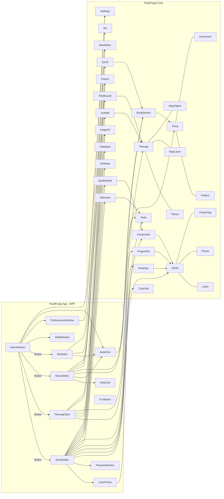

# Trenutna arhitektura (stanje 19. 10. 2026, commit 9144477 + Faza 0)

Diagram vsebuje samo dejanske tipe iz `src/`. Puščica pomeni »uporablja«.

## Ključne lastnosti
- **En dokument na zavihek.** Projekta in referenc med datotekami ni; tileset je v `.pxm` kopiran.
- **Undo:** `History<T>` hrani cele kopije dokumenta (meja `Settings.UndoLimit`).
- **Zvok:** en `AudioOut` (NAudio `WaveOutEvent`) meša pesem (`SongStream`) in kratke zvoke.
- **Nastavitve:** statični `App.Settings`, sprememba sproži `App.SettingsChanged`.
- **Samodejno shranjevanje:** `MainWindow` vsakih N minut piše `%AppData%\PixelForge\autosave\<indeks><končnica>`. Ob zagonu ponudi obnovitev.
- **Bližnjice:** `MainWindow.OnPreviewKeyDown` → `IEditor.HandleKey`, razen kadar tipko potrebuje kontrolnik (`ControlOwnsKey`).

## Znan tehnični dolg
Glej poročilo Faze 0 v `../sessions/SESSION-2026-10-19-phase0.md`.
