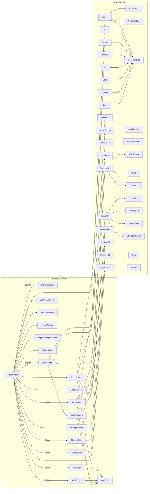

# Trenutna arhitektura (stanje po Fazi 10, 19. 10. 2026)

Diagram vsebuje samo dejanske tipe iz `src/`. Puščica pomeni »uporablja«. Starejše stanje (pred Fazo 1) je v zgodovini gita.

## Ključne lastnosti
- **Projekt** (`.pfproj`, ADR-0001): sredstva s stalnimi GUID, relativne poti, reference med sredstvi samo prek ID. Brez projekta zavihki delujejo kot samostojni urejevalniki datotek.
- **Formati:** vsak ima `Version`, migracijo in zlati primerek (`tests/.../Fixtures`, `Fixtures/current`). Shranjevanje je atomično (`DocumentFile`), ob migraciji `.v<n>.bak`.
- **Undo:** `History<T>` hrani kopije; za sprajte in mape velja še pomnilniški proračun (privzeto 512 MB, najnovejši korak ostane).
- **Zgodovina različic** (ADR-0003): `.history` v projektu, beleži se ob odpiranju in shranjevanju.
- **Zvok:** en `AudioOut` (NAudio) meša pesem, kratke zvoke in posnetek z zanko in položajem (Audio studio, predogled igre).
- **Predogled igre:** `Sandbox` dela na kopiji prizora; `SceneRenderer` riše v ločljivosti igre.
- **Izvoz:** `Exporter` gradi datoteke v pomnilniku, zamenja izhodno mapo v enem koraku; profila Generic in Godot 4.
- **Vtičniki** (ADR-0002): samo podatki, strogo preverjeni; ukazi v paleti ukazov.
- **Nastavitve in samodejno shranjevanje:** `%AppData%\Pixelkiln` ali `PIXELKILN_HOME`.

## Preverjanje
- `dotnet test`: enotski, regresijski (zlati primerki) in obremenitveni testi (`Category=Load`).
- `tools/smoke.ps1`: zažene aplikacijo v ločenem domu, obišče zavihke Sprite, Character in Tilemap, odpre Getting started, začetni zaslon, paleto ukazov, Template Studio in zgodovino ter izvozi projekt (koraki za izklopljene dele so v `if ($false)`).
