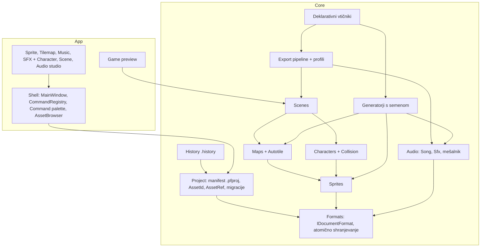

# Ciljna arhitektura (predlog Faze 0)

Obstoječe datoteke ostanejo enote vsebine; projekt jih povezuje s stabilnimi ID-ji. Core ostane en sklop z mapami; App dobi lupino (Shell) in mape urejevalnikov.

## Modeli (povzetek)

| Model | Datoteka | Bistvo |
|---|---|---|
| Project | `.pfproj` | `schemaVersion`, `id`, `name`, `settings`, `assets[]`, `exportProfiles[]` |
| AssetEntry | v manifestu | `id` (GUID), `type`, `path` (relativna), `name`, `tags[]`, `favorite`, `modifiedUtc` |
| AssetRef | v sredstvih | `{ assetId }`; reference nikoli ne uporabljajo poti |
| Tilemap v3 | `.pxm` | + `tilesetAssetId?` (vgrajene pike ostanejo kot rezerva) |
| Character | `.pxchar` | `spriteAssetId`, `animations{ime → oznaka}`, `origin`, `facing`, `boxes[]` |
| Scene | `.pxscene` | `size`, `camera`, `layers[]` (paralaksa, z), `instances[]`, `areas[]` |
| CollisionSettings | v projektu | `categories[]`, `masks{}` |
| ExportProfile | v projektu | `target` (AsepriteJson, TiledTmj, Godot4, Wav, Png), `options`, `outputDir` |
| History | `.history/` | `objects/<sha256>`, `index.json`, meje N različic in MB (ADR-0003) |
| Plugin | `plugins/<id>/plugin.json` | `apiVersion`, `contributions{}`, samo podatki (ADR-0002) |

## Pravila
- `IDocumentFormat<T>`: `Load`, `Save`, `CurrentVersion`, `Migrate`. Shranjevanje v `.tmp` in `File.Replace`. Pred prvim shranjevanjem po migraciji `.v<n>.bak`.
- Samostojne datoteke se še vedno odpirajo brez projekta.
- Skupno stanje dokumenta (pot, spremembe, undo, naslov, potrditev) se izvleče v `DocumentHost`, preden nastane peti urejevalnik.

ADR: [0001](adr/ADR-0001-project-and-asset-ids.md), [0002](adr/ADR-0002-declarative-plugins.md), [0003](adr/ADR-0003-history-store.md).
