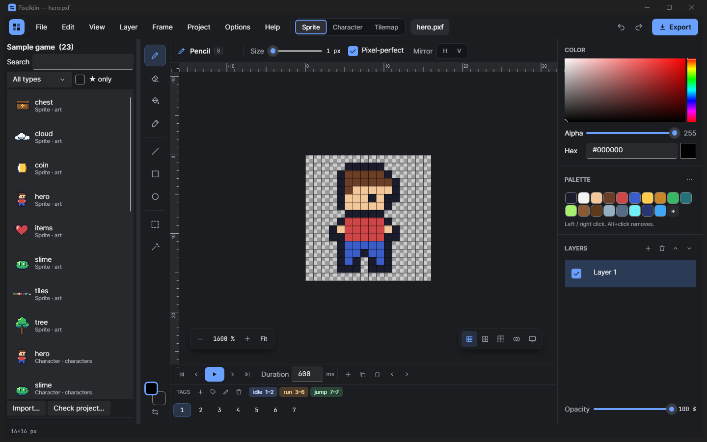
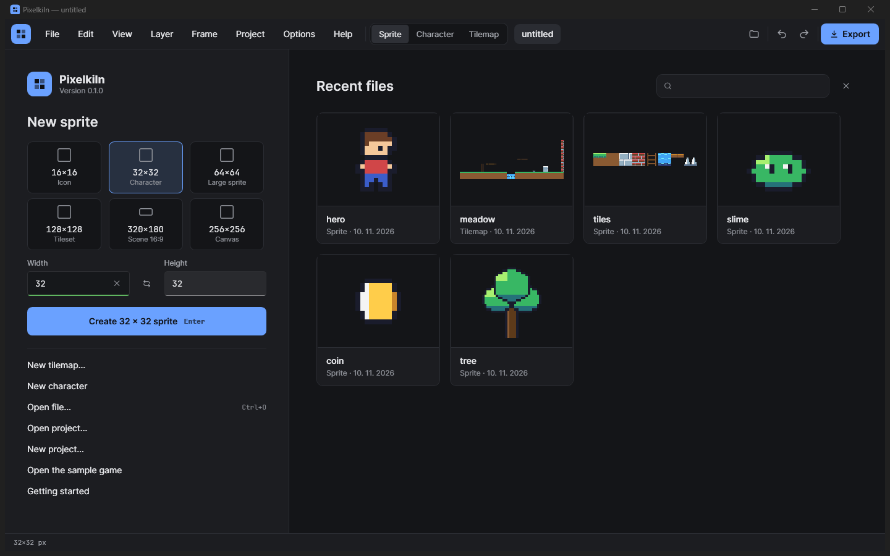
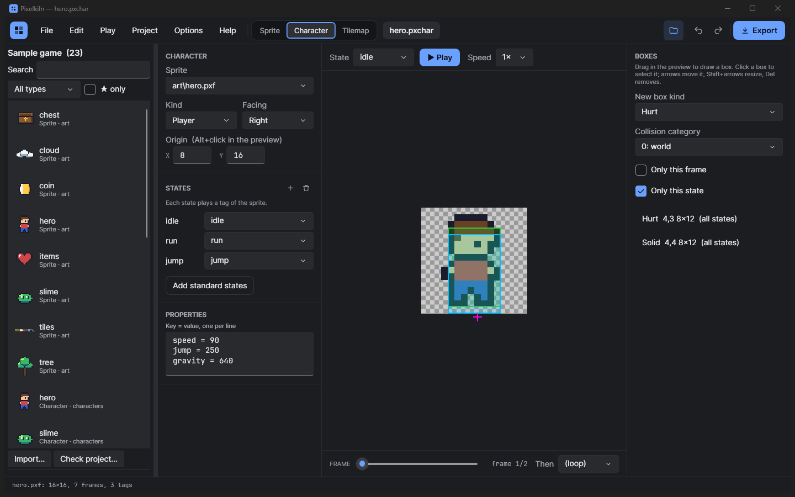
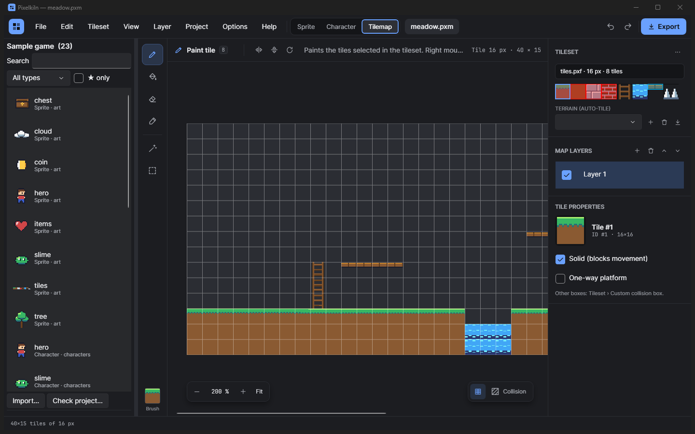

# Pixelkiln

A desktop tool for making 2D game art in one place: draw pixel sprites, turn them into animated characters, and build tilemaps from them.

Runs on Windows (.NET 10, WPF). No network, no accounts; everything stays in your own folders.



> Version 0.1.0, an early release. The Godot export has not been tried in a real Godot project yet, so check the import the first time you use it.

## What it does

| Tab | For |
|---|---|
| **Sprite** | Pixel art with layers, frames, animation tags, onion skin, palettes, selection and transforms. Exports PNG, sprite sheets, Aseprite JSON and GIF. |
| **Character** | A character on top of a sprite: states mapped to animation tags, origin, hurt/hit/solid/trigger boxes, properties for the game. |
| **Tilemap** | Tile layers, flipped and rotated tiles, objects, auto-tile terrains (16 and 47 tiles), per-tile collisions, tileset and layout generators. Exports Tiled TMJ. |

Around them: a start screen with size presets, recent files and a new sprite, tilemap or character, projects with an asset browser, version history, a command palette (Ctrl+Shift+P), templates (Ctrl+T), autosave and recovery, keyboard access everywhere (F1 lists the shortcuts).

| Start screen | Character | Tilemap |
|---|---|---|
|  |  |  |

## From sprite to map

The three tabs work on the same files, so the steps between them are one click:

- **Sprite › Make a character** starts a character on the open sprite, with one state for each animation tag.
- **Sprite › Use as tileset** hands the sprite to the Tilemap tab as its tileset.
- **Tilemap › Edit tile in Sprite** opens the tileset in the Sprite tab with the tile selected.
- When you save a sprite, the map and the character that use it show the change straight away.

You can work without a project. The first time you save into a folder, the app asks whether to make that folder a project; say no and it does not ask again for that folder.

## Download

Each release on the [Releases page](https://github.com/zangrajfo-ship-it/Pixelkiln/releases) has a zip for 64-bit Windows with .NET included, so nothing needs to be installed: unzip it and start `Pixelkiln.App.exe`.

- The app is not signed, so Windows may show "Windows protected your PC" the first time. Choose **More info**, then **Run anyway**. The `.sha256` file next to the zip lets you check the download.
- Settings, autosave and `crash.log` are in `%AppData%\Pixelkiln`. To remove the app, delete its folder (and that one, to remove the settings too).
- If something unexpected goes wrong, the app says so and stays open, so you can still save your work; the details go to `crash.log`. Please attach it when you [report a bug](https://github.com/zangrajfo-ship-it/Pixelkiln/issues).

## Build and run

You need Windows and the [.NET 10 SDK](https://dotnet.microsoft.com/download).

```bash
dotnet run --project src/Pixelkiln.App
```

For development:

```bash
dotnet build
dotnet test
powershell -File tools/smoke.ps1
```

`tools/smoke.ps1` starts the built app in a temporary settings folder and clicks through it with UI Automation (0 = OK, 1 = failure, 2 = the window could not get the foreground, so some steps did not run).

`tools/publish.ps1` builds the release zip into `artifacts/`. Pushing a tag such as `v0.1.0` (the version in `Directory.Build.props`) runs the same script on GitHub and opens a draft release with the zip attached.

Two environment variables help with testing: `PIXELKILN_HOME` moves the settings folder away from `%AppData%\Pixelkiln`, and `PIXELKILN_TIMING=1` writes the start-up steps and their times to `startup.log` in that folder.

## First steps

**Help › Getting started** has three short lessons (sprite, character, tilemap). Each one opens the matching file of the **sample game** (Help › Open sample game), which is created in `Documents\Pixelkiln samples`.

## Projects

**Project › New project** or **Make a project from a folder** creates a `.pfproj` file next to your assets. Assets get stable ids, so renaming and moving files does not break references between them. Deleted assets go to `.trash`, saved versions to `.history`, exports to `export/`.

The asset browser on the left appears when a project is open; the folder button in the top bar (Ctrl+Shift+B) shows or hides it.

## Export

- **Godot 4** (4.3 or newer): `SpriteFrames`, `TileSet` with collisions, `TileMap`, character scenes. Copy the export folder into your Godot project (`res://assets/…`). The steps and a checklist for the first import are in [docs/godot.md](docs/godot.md) (Slovenian).
- **Generic:** PNG (also at several scales), Aseprite JSON, Tiled TMJ, character JSON, `project.json`, optionally one atlas.
- Without a project, the **Export** button lists the exports of the open file (PNG, GIF, sprite sheet, character JSON, Tiled).
- The project export is deterministic, checks the project first and never leaves half-written files. The list of written files is in `export-report.txt`.

## More in the code

The repository also contains editors that are switched off in this version: scenes and levels with a game preview, music and sound effects, an audio mixer, digital painting, vector drawing, textures, UI kits, cutout rigs, animation clips and visual logic. They compile and have tests. To bring one back, add its name to `Shown` in `src/Pixelkiln.App/MainWindow.Shell.cs` or remove the comment in `HostModes` in `MainWindow.xaml.cs`.

## Documentation

The documents in `docs/` are written in Slovenian:

- [docs/README.sl.md](docs/README.sl.md): this page in Slovenian, with the switched-off parts described
- [docs/godot.md](docs/godot.md): export to Godot 4 step by step, with a checklist for the first import
- [docs/formats.md](docs/formats.md): every file format and its versions; older files always open (golden files in `tests/Pixelkiln.Core.Tests/Fixtures`)
- [docs/plugins.md](docs/plugins.md), [docs/templates.md](docs/templates.md): data-only plugins and templates (no code is loaded)
- [docs/design.md](docs/design.md): colours, fonts and layout of the Modern theme
- [docs/adr](docs/adr): architecture decisions

## Licence

[MIT](LICENSE). The bundled fonts Inter and JetBrains Mono are under the SIL Open Font License 1.1 (`src/Pixelkiln.App/Fonts`). The only external dependency is NAudio.WinMM (MIT), used for sound playback.
